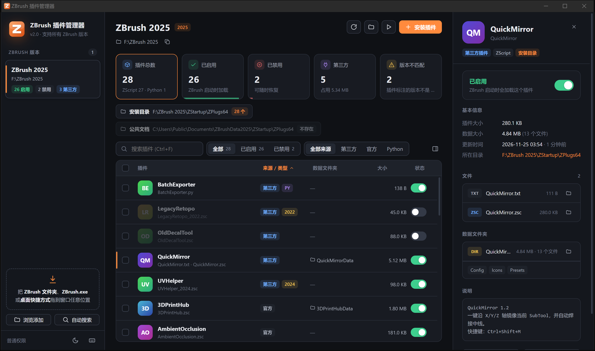
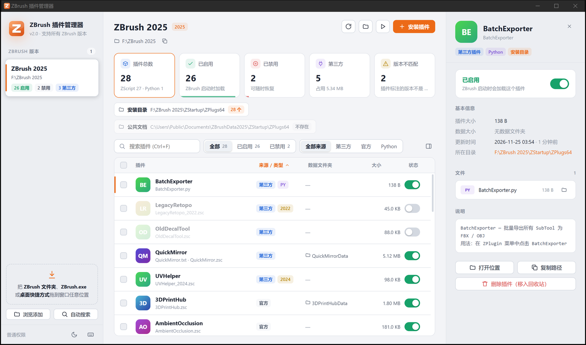

<p align="center"></p>

<h1 align="center">ZBrush 插件管理器</h1>

<p align="center">把 ZBrush 文件夹或快捷方式拖进窗口，就能看到它的全部插件，一键启用、禁用、安装、删除。<br>不用再一层层翻 <code>ZStartup\ZPlugs64</code> 目录。</p>

<p align="center"><a href="../../releases/latest"><b>⬇ 下载最新版</b></a> · Windows 10 / 11 · 免安装</p>



> 觉得好用的话，点个 ⭐ Star 支持一下 · If you find it useful, please give it a ⭐ Star!

## 功能

- **支持所有 ZBrush 版本**（2018 – 2025+），可以同时管理多个版本，在左侧一键切换
- **拖进来就能用**：拖入 ZBrush 安装文件夹、`ZBrush.exe` 或桌面快捷方式，自动定位插件库；启动时还会从注册表、开始菜单、桌面自动搜索
- **插件一览**：官方 / 第三方、ZScript / Python、数据文件夹、占用空间、更新时间、为哪个 ZBrush 版本制作（版本不匹配会提示）
- **启用 / 禁用不删文件**：禁用的插件被移到 `_PluginManager_Disabled` 备用目录，ZBrush 不会加载，随时可以恢复
- **安装插件**：把 `.zsc`、`.py`、`.zip` 或插件文件夹拖进窗口；压缩包里的 `ZPlugs64` 结构会被自动识别，覆盖前旧文件进回收站
- **删除进回收站**，可选择同时删除数据文件夹
- **详情面板**：文件清单、数据文件夹内容、插件自带的说明文字
- 批量操作、搜索、筛选、排序、快捷键，深色 / 浅色主题
- 窗口大小按显示器分辨率计算，并记住上次所在的显示器和位置；ZBrush 正在运行时会提醒



## 会扫描哪些目录

| 位置 | 路径 |
|---|---|
| 安装目录 | `<ZBrush>\ZStartup\ZPlugs64`（以及老版本的 `ZPlugs`） |
| 公共文档 | `C:\Users\Public\Documents\ZBrushDataXXXX\ZStartup\ZPlugs64` |

所有改动都在重启 ZBrush 后生效。ZBrush 装在 `C:\Program Files` 下时需要管理员权限，程序会提示以管理员身份重启。

## 快捷键

| 按键 | 作用 |
|---|---|
| 空格 / 双击 | 启用或禁用 |
| Ctrl / Shift + 单击 | 多选 |
| Ctrl + A | 全选当前列表 |
| Delete | 删除（进回收站） |
| Ctrl + F | 搜索 |
| F5 | 刷新 |
| ↑ ↓ | 上下切换 |

## 从源码运行 / 打包

需要 Python 3.10+ 和 Microsoft Edge WebView2（Windows 10/11 一般自带）。

```powershell
pip install -r requirements.txt
python ZBrushPluginManager.py
```

打包成单个 exe：

```powershell
pip install pyinstaller
.\build.ps1
```

| 文件 | 说明 |
|---|---|
| `ZBrushPluginManager.py` | 窗口、显示器位置记忆、给界面调用的接口 |
| `zbpm_core.py` | ZBrush 识别、插件扫描、启用 / 禁用 / 安装 / 删除 |
| `ui/index.html` | 界面 |

配置文件保存在 `%APPDATA%\ZBrushPluginManager\config.json`。

## 许可

[MIT](LICENSE)。ZBrush 是 Maxon 的商标，本项目是独立的第三方工具，与 Maxon 无关。
